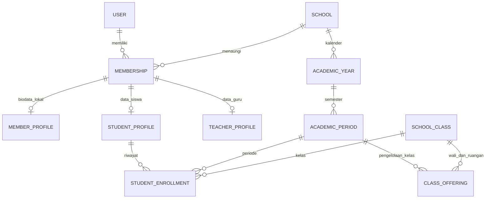

# CRUD dan struktur data sekolah — v0.6.0

Rilis ini melengkapi pengelolaan data dasar yang sebelumnya baru sebagian tersedia.
Backend Smart Study Hub 2.0 lama dipakai sebagai referensi biodata, kelas, program
keahlian dan periode. Implementasi baru memakai relasi PostgreSQL per sekolah;
tidak mengimpor data MongoDB lama secara otomatis.

## Cakupan yang tersedia

Semua path berikut diawali `/api/v1`. Kirim `Authorization: Bearer <access_token>`
dan `X-School-ID: <school_uuid>`. Operasi perubahan memerlukan admin sekolah.

| Data | Sebelum v0.6 | Sekarang |
|---|---|---|
| Akun dasar | Buat/list teacher atau student melalui `/users` | Tetap kompatibel; tersedia registrasi akun + profil dalam satu transaksi |
| Siswa | Buat/list profil, enrollment, transisi | Registrasi, list, detail, ubah biodata, nonaktifkan/pulihkan akses |
| Guru | Akun dan penugasan mengajar | Profil kepegawaian, registrasi, list, detail, ubah, nonaktifkan/pulihkan akses |
| Admin sekolah | Admin awal dan linking akun oleh platform admin | Buat admin lokal baru, list, detail, ubah biodata, nonaktifkan/pulihkan akses |
| Mata pelajaran | CRUD lengkap | Tetap lengkap; penghapusan mapel yang dirujuk penugasan/ujian ditolak FK |
| Tahun ajaran | Angka tahun pada semester | Entitas tersendiri dengan label `2026/2027`, deskripsi, CRUD |
| Semester | Buat/list/tutup | Tambahan detail, koreksi tanggal sebelum dipakai, hapus bila belum dirujuk |
| Program keahlian | Buat/list khusus SMK | Tambahan deskripsi, detail, ubah, hapus bila belum dirujuk |
| Katalog kelas | Buat/list | Tambahan detail, ubah, hapus bila belum dirujuk |
| Wali kelas per semester | Belum tersedia | CRUD `class-offerings`: periode, kelas, wali kelas, ruangan |

Direktori siswa/guru/admin dan biodata lengkap hanya bisa dibaca admin sekolah.
Siswa tetap membaca profil dan enrollment miliknya melalui endpoint `/student/...`.
Guru melihat nama/NIS peserta hanya melalui roster ujian yang berhak dia kelola.
List menggunakan `limit` 1–100 (default 20), `offset` 0–10000.
Direktori menerima `active=true/false` untuk memfilter **membership**, bukan status kelulusan.

## Pemisahan identitas, biodata, dan riwayat



`User` menyimpan identitas login global: email, nama akun, hash password dan flag
platform. `Membership` menyimpan role, status akses dan `revision` **per sekolah**.
`MemberProfile` menyimpan biodata milik sekolah. Mengubah nama/nomor telepon siswa
di sekolah A tidak mengubah profil sekolah B atau email/password akun global.
Nama pada direktori `/users`, daftar guru kolaborasi dan roster memakai nama lokal
sekolah; `/users/me` tetap menunjukkan identitas global.

| Entitas | Field utama dan aturan |
|---|---|
| `MemberProfile` | `full_name` wajib; `gender` (`male`/`female`), `birth_date`, `birth_place`, `phone_number`, `address` opsional dan dibatasi panjangnya |
| `Membership` | `school_id`, `user_id`, `role` (`admin`, `teacher`, `student`), `is_active`, `revision`; satu role utama per sekolah |
| `StudentProfile` | `user_id`, `student_number` (NIS lokal), `nisn` tepat 10 digit, `admitted_on`, `previous_school`, `graduation_grade`, status dan tanggal lulus |
| `TeacherProfile` | `user_id`, `employee_number`, `nip` opsional tepat 18 digit, `employment_type` (`permanent`, `contract`, `honorary`), `qualification`, `joined_on` |
| `AcademicYear` | UUID, `year_start`, label terhitung, `description`, `revision`; unik sekolah + tahun awal |
| `AcademicPeriod` | UUID, sekolah + tahun awal, semester 1/2, `starts_on`, `ends_on`, `status` open/closed, `revision` |
| `SchoolClass` | Nama kelas, tingkat 7–13 sesuai sekolah, program opsional khusus SMK, `revision`; katalog dapat dipakai kembali pada semester berikutnya |
| `ClassOffering` | `period_id`, `class_id`, `homeroom_teacher_id` (ID **user** guru, opsional), `room`, `revision`; unik sekolah + semester + kelas |
| `StudentEnrollment` | Profil siswa, semester, kelas, status transisi dan revisi; riwayat tetap terpisah dari biodata |
| `TeachingAssignment` | Periode, kelas, mapel dan ID user guru; seorang guru dapat memiliki banyak penugasan |

NIS, NISN, nomor pegawai dan NIP unik **di dalam sekolah** ketika diisi. Semuanya
bertipe string agar angka nol di awal tidak hilang. NIP tidak wajib karena tidak
semua guru memilikinya. Biodata tidak mewajibkan NIK, data keuangan atau data orang
tua yang belum digunakan fitur ini. Tanggal lahir tidak boleh di masa depan;
tanggal masuk siswa/guru tidak boleh mendahului tanggal lahir yang diberikan.

SMP hanya kelas 7–9 tanpa program keahlian; SMA kelas 10–12 tanpa program keahlian;
SMK kelas 10–13 dengan program opsional. Jalur kelulusan SMP=9, SMA=12,
SMK=12 atau 13. Setelah siswa memiliki enrollment, perubahan jalur kelulusan
melalui CRUD ditolak. Koreksi jalur siswa aktif perlu alur migrasi akademik khusus.

Wali kelas disimpan per semester supaya pergantian guru tidak menimpa wali kelas
periode sebelumnya. `ClassOffering` merupakan metadata pengelolaan kelas;
anggota kelas tetap berasal dari `StudentEnrollment`. Tidak harus membuat offering
untuk memakai alur enrollment versi sebelumnya. Wali kelas tidak otomatis menjadi
koordinator mapel atau memperoleh akses soal/ujian tambahan.

## Endpoint direktori

| Metode dan path | Kegunaan |
|---|---|
| `POST /students/register` | Buat akun baru + membership student + biodata + profil siswa secara atomik |
| `POST /students` | Lengkapi akun student yang **sudah menjadi anggota sekolah ini**, dengan `user_id` dan data akademik |
| `GET /students`, `GET /students/{id}` | List/detail profil siswa dan objek `member` |
| `PUT /students/{id}` | Ganti biodata + field siswa dengan `expected_revision` dari `member.revision` |
| `DELETE /students/{id}?expected_revision=N` | Nonaktifkan akses sekolah; profil/enrollment/ujian dipertahankan |
| `POST /students/{id}/restore` | Pulihkan akses dengan body `{"expected_revision":N}` |
| `POST /teachers/register` | Buat akun baru + membership teacher + biodata + profil guru |
| `POST /teachers` | Lengkapi profil untuk membership teacher lokal yang belum mempunyai profil |
| `GET /teachers`, `GET /teachers/{id}` | List/detail profil guru dan objek `member` |
| `PUT /teachers/{id}` | Ubah biodata/kepegawaian; pakai `member.revision` |
| `DELETE /teachers/{id}?expected_revision=N` | Nonaktifkan akses sekolah |
| `POST /teachers/{id}/restore` | Pulihkan akses sekolah |
| `POST /school-admins` | Buat akun admin sekolah baru; tidak memberikan hak platform admin |
| `GET /school-admins`, `GET /school-admins/{user_id}` | List/detail admin lokal |
| `PUT /school-admins/{user_id}` | Ubah biodata lokal dengan `expected_revision` |
| `DELETE /school-admins/{user_id}?expected_revision=N` | Nonaktifkan admin, dengan perlindungan admin terakhir |
| `POST /school-admins/{user_id}/restore` | Pulihkan akses admin sekolah |

UUID pada `/students/{id}` dan `/teachers/{id}` adalah **ID profil**, berbeda dari
`user_id` untuk login, membership, koordinator, penugasan mengajar dan wali kelas.
Respons menyertakan keduanya. Admin sekolah tidak memiliki profil profesi terpisah,
sehingga endpoint admin menggunakan `user_id`.

Contoh `POST /students/register`:

```json
{
  "email": "siswa@example.org",
  "password": "contoh-ganti-password-ini",
  "full_name": "Budi Santoso",
  "birth_date": "2010-05-10",
  "student_number": "20260001",
  "nisn": "0012345678",
  "admitted_on": "2026-07-01",
  "previous_school": "SMP Contoh",
  "graduation_grade": 12
}
```

Sesudah registrasi, panggil `POST /student-enrollments` dengan ID profil siswa,
periode dan kelas. Naik kelas, lanjut semester, tinggal kelas, lulus dan keluar
tetap memakai [alur transisi enrollment](SISWA_DAN_PELAKSANAAN_UJIAN.md).
Jangan menulis `class_id`, role atau status lulus melalui PUT biodata.

Contoh `POST /teachers/register`:

```json
{
  "email": "guru@example.org",
  "password": "contoh-ganti-password-ini",
  "full_name": "Siti Aminah",
  "employee_number": "G001",
  "employment_type": "contract",
  "qualification": "S1 Pendidikan Matematika",
  "joined_on": "2026-07-01"
}
```

Untuk admin gunakan `POST /school-admins` dengan email, password, nama dan biodata
opsional. Email yang sudah digunakan mengembalikan 409; API tidak otomatis
menautkan atau mengganti password akun tersebut. Penautan akun global yang sudah
ada tetap dibatasi ke platform admin melalui `/schools/current/memberships`.

`POST /users` lama tetap menerima hanya teacher/student. Untuk teacher, profil
guru kosong dibuat otomatis; untuk student, pilih `graduation_grade` dan buat
profil melalui `/students`, atau gunakan `/students/register` sejak awal.

## Endpoint katalog akademik

| Resource | Metode |
|---|---|
| `/academic-years` | POST, GET list; GET/PUT/DELETE `/{id}` |
| `/academic-periods` | POST, GET list; GET/PUT/DELETE `/{id}`; POST `/{id}/close` |
| `/expertise-programs` | POST, GET list; GET/PUT/DELETE `/{id}` |
| `/classes` | POST, GET list; GET/PUT/DELETE `/{id}` |
| `/class-offerings` | POST, GET list dengan `period_id`; GET/PUT/DELETE `/{id}` |
| `/subjects` | POST, GET list; GET/PUT/DELETE `/{id}` — kontrak CRUD lama tetap |

PUT katalog baru wajib `expected_revision`; DELETE wajib query `expected_revision`.
Tanggal semester inklusif, semester 1 harus mendahului semester 2, dan rentang
kalender antar tahun juga tidak boleh tumpang tindih. Status `open` berarti
operasi akademik masih diperbolehkan, bukan berarti semester tersebut sedang
berlangsung hari ini. Periode masa depan boleh dibuat lebih dahulu.

Contoh tahun dan semester:

```json
{"year_start":2027,"description":"Tahun ajaran 2027/2028"}
```

```json
{"year_start":2027,"semester":1,"starts_on":"2027-07-01","ends_on":"2027-12-31"}
```

POST semester tetap bisa membuat wadah tahun ajaran otomatis untuk kompatibilitas.
Identitas `year_start` dan nomor semester tidak boleh diganti melalui PUT;
buat entitas baru untuk tahun/semester berbeda. Tanggal semester hanya dapat
dikoreksi sebelum dirujuk penugasan, kelompok koordinasi, enrollment atau offering.
Semester berisi riwayat ditutup, bukan dihapus. Tahun ajaran yang masih berisi
semester tidak dapat dihapus.

Nama kelas dapat dikoreksi, tetapi tingkat/programnya tidak dapat diubah setelah
digunakan. Buat kelas tujuan dan gunakan transisi enrollment. Penamaan katalog
dibaca sebagai label terbaru; dokumen rapor historis dengan snapshot nama belum
diimplementasikan. Kelas/program/mapel yang masih dirujuk ditolak saat dihapus.
Offering hanya dapat diubah/dihapus pada periode terbuka.

## Konsistensi dan keamanan

- **PUT mengganti seluruh field yang dapat diedit.** Field opsional yang tidak
  dikirim kembali menjadi `null`. Frontend perlu mengisi form dengan nilai GET,
  lalu mengirim seluruh field form bersama revisinya; jangan mengirim objek GET
  mentah karena ID, `member`, status dan field output lain ditolak sebagai input.
- Revisi lama menghasilkan 409. Row lock PostgreSQL menserialisasi perubahan;
  dua API tidak boleh diam-diam menimpa revisi yang sama. Muat ulang dan selesaikan
  konflik sebelum menyimpan lagi.
- Kalender diserialisasi dengan lock baris sekolah `FOR NO KEY UPDATE`.
  Lock ini tetap mengizinkan pemeriksaan foreign key dari transaksi akademik,
  sehingga tidak membentuk siklus tunggu dengan audit/enrollment.
- Guru yang masih menjadi koordinator atau wali kelas pada periode terbuka tidak
  dapat dinonaktifkan sebelum tugas tersebut dicabut/dipindahkan. Penugasan
  mengajar historis dipertahankan. Aktivasi kembali tidak mengganti penugasan itu.
- Siswa dengan attempt ujian yang masih berjalan tidak dapat dinonaktifkan.
  Start ujian dan penonaktifan mengunci profil dengan urutan yang konsisten.
- Sekolah harus tetap memiliki setidaknya satu admin dengan akun dan membership
  aktif, termasuk saat dua admin mencoba saling menonaktifkan secara bersamaan.
- DELETE direktori hanya menonaktifkan membership pada sekolah terpilih. Login
  global dan membership sekolah lain tetap tersedia. REST memeriksa membership
  pada request berikutnya; koneksi WebSocket lama mengecek ulang sekitar 20 detik.
  Restore akses tidak membatalkan status lulus/keluar atau membuka ulang enrollment.
- Empat tabel baru memakai PostgreSQL **FORCE RLS**. Composite FK mengikat relasi
  ke sekolah yang sama. Runtime tetap tanpa SUPERUSER/BYPASSRLS.
- Biodata dibaca langsung dari PostgreSQL dengan join dan pagination; tidak masuk
  cache bersama atau payload Pub/Sub. Audit menyimpan aktor, ID resource, aksi dan
  revisi, tanpa password, alamat, NIP/NISN atau isi form. Kode hasil/solusi ujian
  tetap mengikuti pembatasan akses versi sebelumnya.

Rilis ini belum menambahkan role admin sekaligus guru pada satu membership,
reset kredensial global oleh admin sekolah, impor massal, akun orang tua,
foto profil/upload, rapor, absensi atau integrasi Dapodik. Penugasan guru lintas
mapel/kelas dan hak koordinator sudah didukung tanpa mengganti role utama.

## Migrasi dan verifikasi

Migrasi `b60a9c12de73` setelah `a51d8e70bc92`:

1. Membentuk tahun ajaran dari semester yang sudah ada.
2. Menyalin nama akun menjadi nama profil lokal untuk setiap membership, termasuk
   membership nonaktif, tanpa mengaktifkan kembali aksesnya.
3. Membuat profil kosong untuk membership teacher yang sudah ada.
4. Menambahkan field opsional, revisi, unique/check constraint, composite FK,
   index dan kebijakan RLS. Riwayat dan UUID data lama tetap dipertahankan.

Lakukan backup terverifikasi dan hentikan penulisan dari API/worker/beat lama
selama pergantian schema dan proses. Untuk instalasi Python langsung:

```bash
uv sync --frozen
uv run alembic upgrade head
uv run python -m studyhub.provision  # hanya development: grant tabel baru
```

Produksi menggunakan role migrasi melalui proses release terpisah; pastikan
role runtime mendapat izin tabel baru tanpa bypass RLS. Setelah migrasi,
jalankan ulang API, worker dan beat dari source yang sama. Proses lama yang tidak
mengetahui revisi atau FK tahun ajaran tidak boleh terus menulis selama upgrade.

Downgrade diperbolehkan untuk backfill default yang dapat dibentuk kembali.
Downgrade yang membuang biodata tambahan, offering, metadata tahun baru atau
perubahan revisi ditolak secara transaksional. Pemulihan backup perlu diuji
ketika benar-benar ingin kembali ke versi lama.

Pengujian mencakup registrasi/login, rollback akun saat profil duplikat, CRUD,
RBAC/RLS lintas sekolah, pembatasan jenjang, admin terakhir, edit serentak,
deaktivasi vs start ujian, perubahan kelas vs enrollment, kalender bertabrakan,
serta backfill/downgrade migrasi. Hasil eksekusi dicatat di [verification.md](verification.md).
