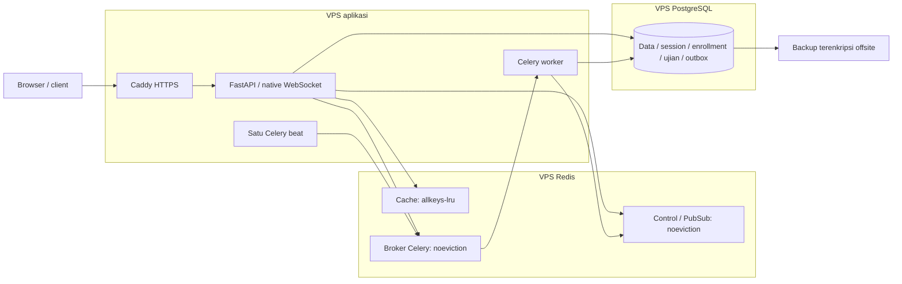

# Deployment: aplikasi, Redis dan PostgreSQL pada tiga VPS

Target utama dokumen ini adalah **satu VPS aplikasi, satu VPS Redis, dan satu VPS
PostgreSQL**. Arsitektur kode sudah mendukung koneksi ke host terpisah. Konfigurasi
deployment lintas host masih harus dibuat dan diuji ketika alamat/kapasitas VPS
tersedia; Compose dalam repository belum merupakan paket siap jalan tiga host.

## Konfigurasi koneksi dan jaringan

- Tentukan jaringan privat yang menghubungkan ketiga VPS. Jika private network
  provider tidak tersedia, gunakan jaringan privat terenkripsi seperti VPN.
- Arahkan `STUDYHUB_DATABASE_URL` ke PostgreSQL eksternal dengan driver
  `postgresql+asyncpg`. Worker membentuk URL psycopg dari konfigurasi tersebut.
- Arahkan `STUDYHUB_CACHE_URL`, `STUDYHUB_CONTROL_URL`, dan `STUDYHUB_BROKER_URL`
  ke tiga instance Redis berbeda di VPS Redis. Perbedaan nomor database saja
  tidak memisahkan eviction, kapasitas, persistence atau Pub/Sub.
- Migrasi memakai `STUDYHUB_MIGRATION_DATABASE_URL` dan role terpisah. Jangan
  menyebarkan credential migrator ke proses API/worker yang tidak membutuhkannya.
- Aktifkan autentikasi dan izin minimum. Firewall PostgreSQL/Redis menerima hanya
  sumber privat yang diperlukan, termasuk host backup/monitoring yang disetujui.
  Terapkan juga `listen_addresses`/`pg_hba.conf` PostgreSQL dan ACL/bind Redis.
- Port publik pada VPS aplikasi untuk ingress HTTP/HTTPS; SSH dibatasi ke akses
  operator/VPN. Jangan membuka datastore atau monitoring ke internet umum.
- Tentukan TLS dan verifikasi sertifikat untuk koneksi datastore, khususnya saat
  jaringan tidak sepenuhnya dipercaya. Jangan sekadar menonaktifkan verifikasi
  agar koneksi berhasil. Pengaturan TLS asyncpg/psycopg/Redis harus diuji bersama
  server dan CA tujuan; panduan ini tidak mengklaim TLS antar-VPS sudah terpasang.

**Perhatian terhadap Compose:** `compose.yaml` menuliskan endpoint `postgres`,
`cache`, `control`, dan `broker` secara eksplisit pada `environment`, serta memakai
`depends_on` untuk service lokal. Mengubah URL di `.env` saja tidak mengganti nilai
tersebut. Siapkan manifest aplikasi lintas host atau override yang mengganti
environment semua proses terkait dan dependensi lokalnya. `depends_on` tidak
menunggu service di VPS lain; gunakan healthcheck, startup retry dan prosedur
release. Jangan menjalankan stack penuh di setiap host karena akan membuat
datastore lokal tambahan yang tidak sengaja dipakai aplikasi.

## Kapasitas, resource dan jadwal

API, worker dan beat boleh berjalan pada VPS aplikasi yang sama. Batasi CPU/RAM
worker agar task berat tidak menghabiskan resource API. Ukur latensi, RAM, query,
CPU dan antrean sebelum menentukan jumlah proses; satu VPS besar tetap memiliki
batas kapasitas.

Budget koneksi maksimum API:

`jumlah proses API × (db_pool_size + db_max_overflow)`

Default per proses sekarang 5 + 5. Empat proses berarti potensi 40 koneksi API,
ditambah pool worker, migrasi, backup dan monitoring. Sisakan koneksi administrasi;
jangan menyamakan seluruh budget dengan `max_connections` PostgreSQL. Jika perlu
PgBouncer, uji kompatibilitas asyncpg/prepared statement dan mode pooling dahulu.

Redis cache boleh kehilangan key dan memakai `allkeys-lru`. Control dan broker
memakai `noeviction` dengan persistence dan volume masing-masing. Sisakan RAM
host untuk overhead Redis/AOF, OS dan operasi persistence; `maxmemory` bukan
batas total penggunaan RAM proses. Pantau rejected writes, disk dan umur outbox.

Jalankan **satu beat per environment**. Sinkronkan waktu seluruh host; deadline
ujian memakai jam PostgreSQL, sedangkan validasi token dan timer juga membutuhkan
jam host yang benar. Backup memakai timer independen dari Celery. Sesuaikan
alamat sumber backup, jalur secret, host tag dan watchdog setelah memindahkan DB;
latihan restore harus tetap menuju database terpisah.

## Konkurensi dan batas keandalan

Satu VPS aplikasi tetap dapat menjalankan request/proses/worker secara bersamaan.
Row lock PostgreSQL, transaksi, revisi dan unique constraint tetap diperlukan.
Rincian implementasi dan kasus yang diuji ada di
[CRUD](CRUD_DAN_STRUKTUR_DATA.md), [ujian](SISWA_DAN_PELAKSANAAN_UJIAN.md),
[arsitektur](architecture.md), dan [verifikasi](verification.md).

- Revisi lama menghasilkan 409; client memuat ulang sebelum menyimpan perubahan.
- Timeout setelah commit dapat membuat hasil request tidak pasti bagi client.
  Gunakan retry dengan idempotency key pada endpoint yang mendukungnya, atau
  rekonsiliasi dengan membaca state. Jangan retry seluruh mutasi tanpa pemeriksaan.
  Tidak semua POST sudah mendukung idempotency key.
- Task/event dapat terkirim ulang. Efek eksternal seperti email/pembayaran perlu
  deduplikasi/idempotensi sendiri; outbox tidak menjamin exactly-once downstream.
- Client menserialkan refresh token; dua pemakaian token lama secara bersamaan
  dianggap replay dan bisa mencabut session.
- Redis Pub/Sub tidak menyimpan riwayat. Setelah reconnect, client membaca ulang
  status melalui HTTP. Cache statistik bersifat eventually consistent; keputusan
  otorisasi dan akademik membaca PostgreSQL.
- Gangguan jaringan, deadlock atau timeout bisa menggagalkan transaksi. Kegagalan
  harus ditangani client sesuai status/idempotensi, tanpa mengasumsikan semua
  request akan otomatis diulang oleh server.

Pemisahan tiga host tidak menyediakan HA: VPS aplikasi mati menghentikan API,
VPS PostgreSQL mati menghentikan akses data, dan kegagalan Redis control/broker
mengganggu layanan terkait. Backup membantu pemulihan, bukan failover otomatis.
HA, PITR dan target RPO/RTO memerlukan keputusan serta implementasi tambahan.

## Jika nanti menambah beberapa VPS aplikasi

- Semua replica menggunakan database/Redis bersama, namespace environment yang
  sama, konfigurasi penandatanganan token yang konsisten dan source/schema kompatibel.
  Jangan memakai namespace berbeda per VPS untuk satu aplikasi yang sama.
- Load balancer mendukung WebSocket upgrade, timeout, healthcheck, draining dan
  penghapusan target yang tidak sehat. Koneksi WebSocket berlangsung pada instance
  yang menerimanya; Redis meneruskan event antarproses. Sticky session bukan
  pengganti pengelolaan state bersama.
- Trust forwarded headers hanya dari proxy yang dikenal agar IP rate limit tidak
  dapat dipalsukan. Sesuaikan Caddy/proxy trust yang saat ini berorientasi satu host.
- Batas koneksi WebSocket saat ini per proses, bukan kuota global. Kuota global
  memerlukan lease terdistribusi. Pantau metrik setiap proses/replica.
- Hitung ulang pool koneksi untuk seluruh host. Jalankan satu migrasi release dan
  satu beat; jangan menggandakan scheduler pada semua VPS aplikasi.
- File upload persisten mendatang perlu penyimpanan bersama/object storage;
  jangan bergantung pada disk lokal replica. Fitur upload belum disediakan.

## Checklist penerapan dan bukti

Daftar ini belum ditandai selesai karena belum ada deployment tiga VPS nyata.

- [ ] Inventaris IP privat, domain, kapasitas, akses operator dan sinkronisasi waktu.
- [ ] Manifest lintas host: endpoint, dependensi, healthcheck dan secret setiap proses.
- [ ] Firewall, izin database/Redis, TLS dan pembatasan port diverifikasi dari luar/dalam.
- [ ] Backup offsite aktif, receiver alert teruji dan restore ke DB terpisah berhasil.
- [ ] Role runtime terbatas, grant tabel baru, migrasi dan restart release diperiksa.
- [ ] Smoke test login/refresh/logout, RBAC lintas sekolah, CRUD, ujian dan WebSocket.
- [ ] Uji beban representatif; catat throughput, p95/p99, error, koneksi DB dan antrean.
- [ ] Uji request serentak, retry setelah timeout dan worker mati di sekitar commit.
- [ ] Uji Redis/PostgreSQL restart atau putus jaringan serta pemulihan subscriber/outbox.
- [ ] Tetapkan RPO/RTO, retensi, prosedur insiden dan rollback; catat bukti secara privat.

Lihat [peta dokumentasi](README.md) untuk status implementasi dibanding konfigurasi
produksi. Pengujian sebelumnya menggunakan layanan lokal dan dua proses API;
belum menjadi bukti load/failure test pada tiga VPS berbeda.
