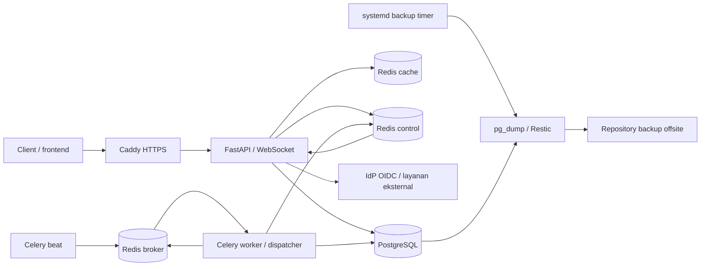

# Dokumen Utama Smart Study Hub Foundation

Dokumen ini menjadi acuan utama untuk memahami, menjalankan, mengembangkan, dan
merawat backend Smart Study Hub Foundation. Cakupan implementasi yang dirangkum
adalah **v0.6.0**. Terakhir ditinjau terhadap source: **11 November 2026**.

Tujuannya adalah menjelaskan teknologi yang dipakai, alasan pemilihannya, fitur
yang tersedia, cara service bekerja bersama, serta pencegahan masalah keamanan
dan keandalan. Instruksi rinci tetap berada di dokumen domain yang ditautkan.

## Daftar isi

1. [Tujuan dan status aplikasi](#1-tujuan-dan-status-aplikasi)
2. [Teknologi dan kegunaannya](#2-teknologi-dan-kegunaannya)
3. [Service dan alur sistem](#3-service-dan-alur-sistem)
4. [Instruksi menjalankan service](#4-instruksi-menjalankan-service)
5. [Fitur dan struktur data](#5-fitur-dan-struktur-data)
6. [Autentikasi, SSO dan otorisasi](#6-autentikasi-sso-dan-otorisasi)
7. [Race condition dan konsistensi](#7-race-condition-dan-konsistensi)
8. [Keamanan umum dan rencana pencegahan](#8-keamanan-umum-dan-rencana-pencegahan)
9. [Logging, audit, monitoring dan insiden](#9-logging-audit-monitoring-dan-insiden)
10. [Backup dan pemulihan](#10-backup-dan-pemulihan)
11. [Deployment dan kapasitas](#11-deployment-dan-kapasitas)
12. [Aturan implementasi dan integrasi](#12-aturan-implementasi-dan-integrasi)
13. [Rencana kerja dan kriteria penerimaan](#13-rencana-kerja-dan-kriteria-penerimaan)
14. [Peta dokumen dan bukti pengujian](#14-peta-dokumen-dan-bukti-pengujian)

## 1. Tujuan dan status aplikasi

Backend ini mendukung beberapa sekolah **SMP, SMA, dan SMK** dalam satu aplikasi.
Fondasi berbentuk monolit modular: domain identitas, akademik, dan asesmen
dipisahkan di dalam source, sementara pekerjaan background berjalan sebagai
proses tersendiri. SSO dan kontrak integrasi disiapkan untuk pengembangan lebih
lanjut, termasuk kemungkinan pemisahan microservice.

Istilah status dalam dokumen ini:

| Status | Artinya |
|---|---|
| **Tersedia** | Implementasinya ada di source/config repository |
| **Teruji lokal** | Ada hasil pengujian yang tercatat, dengan batas lingkungan uji yang disebutkan |
| **Perlu konfigurasi** | Kode atau contoh config tersedia, tetapi perlu pemasangan dan pembuktian pada server tujuan |
| **Direncanakan** | Kebutuhan/arah pengembangan; belum menjadi fitur atau jaminan layanan |

Sebagai contoh, adapter SSO tersedia dan teruji dengan IdP lokal, tetapi IdP
produksi belum dikonfigurasi. Mekanisme backup/restore tersedia dan teruji lokal,
tetapi bucket offsite serta timer pada VPS perlu diaktifkan operator.
Dokumentasi dan hasil tes tidak menyatakan bahwa deployment produksi sudah aktif
atau seluruh kemungkinan celah keamanan sudah tertutup.

## 2. Teknologi dan kegunaannya

Versi persis dependensi dikunci di [uv.lock](../uv.lock), rentang kompatibilitas di
[pyproject.toml](../pyproject.toml). Versi image dan command service berada di
[Compose](../compose.yaml), [Dockerfile](../Dockerfile), dan override operasional.

| Komponen | Pilihan saat ini | Kegunaan / alasan |
|---|---|---|
| Bahasa | Python 3.12+ | API, aturan bisnis, worker dan alat operasional dalam satu ekosistem |
| HTTP API | FastAPI + Uvicorn, ASGI | Request async, dependency autentikasi, validasi, OpenAPI, WebSocket native |
| Validasi/config | Pydantic 2 + Pydantic Settings | Schema input/output eksplisit; konfigurasi divalidasi saat startup |
| Database utama | PostgreSQL 16 | Sumber kebenaran data, transaksi, constraint, row lock dan isolasi tenant |
| ORM API | SQLAlchemy 2 async + asyncpg | Akses PostgreSQL async dengan session/pool yang dikelola aplikasi |
| ORM worker | SQLAlchemy sinkron + psycopg 3 | Sesuai proses Celery prefork; resource dibuat setelah fork |
| Migrasi | Alembic | Perubahan schema terurut dan dapat ditinjau; bukan `create_all` saat startup |
| Cache | Redis 7.4, instance cache | Mempercepat statistik mapel; TTL/generation; data boleh terbuang |
| Kontrol bersama | Redis 7.4, instance control | Rate limit, ticket WebSocket, state OIDC, Pub/Sub dan heartbeat |
| Antrean | Redis 7.4, instance broker | Mengantarkan task ke Celery, terpisah dari cache yang dapat mengalami eviction |
| Background job | Celery prefork | Laporan, dispatcher outbox, rekonsiliasi, penutupan attempt kedaluwarsa dan cleanup |
| Scheduler aplikasi | Celery beat | Memicu task berkala; satu beat aktif per environment |
| Login lokal | Argon2id, JWT, opaque refresh token | Hash password, access token singkat, session/revocation dan rotasi refresh |
| SSO | OpenID Connect (OIDC) | Authorization Code + PKCE; autentikasi melalui Identity Provider (IdP) |
| Real-time | WebSocket native + Redis Pub/Sub | Event privat lintas proses API; status permanen tetap di PostgreSQL |
| HTTP keluar | HTTPX async pooled client | Adapter pihak ketiga dengan endpoint, ukuran respons dan timeout terbatas |
| Logging/audit | JSON logging, request/task ID, audit PostgreSQL | Diagnosis error dan pencatatan tindakan tanpa menyalin isi form/token |
| Monitoring | Prometheus + Alertmanager | Metrik, deteksi gangguan dan pengiriman alert setelah receiver dikonfigurasi |
| Backup | pg_dump/pg_restore 16 + Restic 0.19.1 | Salinan database konsisten, backup terenkripsi dan latihan pemulihan |
| Jadwal host | systemd timers | Backup/watchdog independen dari Celery dan broker |
| Runtime/deployment | Docker Compose + Caddy | Lingkungan service konsisten, reverse proxy HTTPS dan pembatasan ingress |
| Kualitas kode | uv, Ruff, pytest, GitHub Actions | Lock dependensi, lint, unit/integrasi dan otomasi pemeriksaan |

Celery menjalankan task sinkron di proses berbeda dari API, sehingga tidak
memblokir event loop FastAPI. Fungsi `async` tidak membuat proses hashing atau
pekerjaan CPU otomatis ringan; hashing dipindah ke thread dan pekerjaan background
ke worker sesuai kebutuhan. Docker mempermudah deployment, tetapi aplikasi juga
dapat dijalankan sebagai proses Python langsung. Docker volume bukan backup.

Penjelasan teknis lebih rinci: [Panduan teknis](PANDUAN_TEKNIS.md).

## 3. Service dan alur sistem



Diagram menunjukkan hubungan logis service, bukan bukti bahwa semuanya sudah
terpasang di host/domain produksi.

| Service | Tugas dan ketentuan |
|---|---|
| `api` | HTTP/WS; lifespan membuat engine DB dan client Redis/HTTP, lalu menutupnya saat shutdown; satu AsyncSession per request |
| `postgres` | Data identitas, sekolah, akademik, ujian, session, job, outbox dan audit; memerlukan volume serta backup |
| `cache` | Redis `allkeys-lru`; statistik mapel TTL 30 detik; kegagalan cache dapat ditoleransi oleh alur yang memakai fallback |
| `control` | Redis `noeviction` + AOF; kontrol keamanan dan Pub/Sub; memerlukan volume persistence |
| `broker` | Redis `noeviction` + AOF everysec; antrean Celery; memerlukan volume persistence |
| `worker` | Task sinkron; pool DB dibuat lazy di child berdasarkan PID, bukan diwariskan sebelum fork |
| `beat` | Dispatcher 2 detik, rekonsiliasi job 60 detik, expiry attempt 30 detik, cleanup harian 03:15 UTC |
| `migrate` | Release job sementara; upgrade schema sekali dengan role migrasi; tidak menjadi server permanen |
| `caddy` | HTTPS, proxy dan pembatasan akses endpoint internal; perlu domain/DNS/konfigurasi trust proxy yang benar |
| Monitoring | Prometheus, Alertmanager dan watchdog; receiver eksternal dan host pemantau perlu konfigurasi |
| Backup | Runner dari timer host; tidak bergantung pada worker/beat untuk menjadwalkan backup |

### Alur request, task dan event

1. Client mengirim bearer token dan, pada endpoint sekolah, `X-School-ID`.
2. API memeriksa user/session, sekolah, membership dan izin operasi/objek.
3. Service melakukan perubahan dalam transaksi PostgreSQL. Row Level Security
   (RLS) membatasi baris
   sekolah; constraint menjaga relasi dan keunikan.
4. Jika memerlukan task/event, niat pengiriman dicatat di **outbox** pada transaksi
   yang sama. Ini mencegah data tersimpan tanpa catatan pekerjaan yang diperlukan.
5. Dispatcher mengambil outbox, mengirim task ke broker atau event ke Pub/Sub.
   Pengiriman dapat berulang jika proses mati di antara kirim dan commit.
6. Worker menyimpan hasil di PostgreSQL. Subscriber setiap proses API meneruskan
   event privat ke koneksi WebSocket user/sekolah yang sesuai.

Job/event menggunakan kontrak **at least once**: penerima harus siap duplikat.
Pub/Sub tidak menyimpan riwayat; client mengambil ulang state melalui HTTP setelah
reconnect. Cache statistik bersifat eventually consistent. Data otorisasi, kunci
soal dan keputusan akademik tidak bergantung pada cache statistik.

Rincian cache generation, transaksi dan lifecycle: [Arsitektur](architecture.md).

## 4. Instruksi menjalankan service

### Pengembangan lokal dengan Compose

Memerlukan Python 3.12+, Docker Engine dan Compose; override produksi memakai
Compose >=2.24.4. Jalankan dari root repository, menggunakan konfigurasi development.

```bash
python scripts/init_env.py
docker compose up --build -d
docker compose exec api python -m studyhub.cli create-admin \
  --email admin@example.org --name "Administrator"
```

Generator membuat `.env` privat dengan credential acak dan tidak menimpa file
yang sudah ada. CLI meminta password secara interaktif dan membuat platform admin;
buat sekolah melalui API sesudah login. Tidak ada akun/password admin bawaan.
Compose menunggu migrasi sebelum menjalankan service yang bergantung padanya.

```bash
docker compose ps
docker compose logs --since 15m --tail 200 api worker beat
curl --fail http://127.0.0.1:8000/health/ready
```

Swagger lokal ada di `http://localhost:8000/docs`; OpenAPI di
`http://localhost:8000/api/v1/openapi.json`. Liveness `/health/live` memeriksa proses;
readiness `/health/ready` memeriksa DB/schema, broker, control dan subscriber,
serta melaporkan cache degraded. Readiness belum membuktikan worker memproses task.

Untuk menghentikan stack development gunakan `docker compose stop`. Jangan
menghapus volume database/Redis untuk mencoba memperbaiki error koneksi atau
migrasi. Alur menjalankan Python langsung tersedia di [README repository](../README.md).

### Ketentuan service di produksi

1. Tentukan host, jaringan, domain dan kapasitas sebelum memakai manifest produksi.
2. Siapkan secret, role DB, firewall, persistence, backup dan monitoring.
3. Jalankan satu migrasi release; berikan grant tabel baru ke runtime role.
4. Jalankan API/worker/beat dengan source/schema yang kompatibel. Drain/hentikan
   writer lama jika release belum mendukung versi campuran.
5. Periksa readiness, login, job sampai selesai, WebSocket dan akses lintas sekolah.
6. Aktifkan timer/receiver setelah backup, restore dan alert percobaan berhasil.

Variabel penting berikut harus dipetakan pada service yang membutuhkannya:

| Config | Kegunaan |
|---|---|
| `STUDYHUB_ENVIRONMENT` | `production` untuk validasi dan perilaku produksi |
| `STUDYHUB_DATABASE_URL` | Runtime DB, driver `postgresql+asyncpg`; worker membentuk URL psycopg |
| `STUDYHUB_MIGRATION_DATABASE_URL` | Credential DDL untuk proses migrasi; tidak dibagikan ke runtime produksi |
| `STUDYHUB_CACHE_URL`, `STUDYHUB_CONTROL_URL`, `STUDYHUB_BROKER_URL` | Endpoint terpisah untuk tiga fungsi Redis |
| `STUDYHUB_NAMESPACE` | Isolasi environment pada key/channel/task; sama antar replica satu environment |
| `STUDYHUB_JWT_SECRET`, issuer/audience | Penandatanganan dan pembatasan token; secret bukan data untuk GitHub |
| `STUDYHUB_ALLOWED_HOSTS`, `STUDYHUB_ALLOWED_ORIGINS` | Host/origin eksplisit; tanpa wildcard produksi |
| `STUDYHUB_DB_POOL_SIZE`, `STUDYHUB_DB_MAX_OVERFLOW` | Budget koneksi per proses API |
| `STUDYHUB_OIDC_*` | Issuer, client, callback dan pengaturan endpoint IdP |
| Config metrik/backup/receiver | Secret dan lokasi file privat menurut runbook masing-masing |

Nama lengkap, validasi dan default ada di [Settings](../src/studyhub/core/config.py).
URL berkredensial, `.env`, password Restic, CA privat dan token tidak boleh masuk
repository atau log. Runbook pemasangan: [Operasional VPS](OPERASIONAL_VPS.md).

## 5. Fitur dan struktur data

| Domain | Implementasi yang tersedia |
|---|---|
| Identitas | Login lokal, refresh rotation, logout/revocation, adapter SSO OIDC |
| Multi-sekolah | Membership/role lokal, pemilihan sekolah, isolasi tenant SMP/SMA/SMK |
| Direktori | Registrasi/CRUD siswa, guru dan admin sekolah; nonaktifkan/pulihkan akses |
| Master akademik | CRUD mapel, kelas, program SMK, tahun ajaran, semester; wali kelas/ruangan per semester |
| Riwayat siswa | Enrollment, lanjut semester, naik/tinggal kelas, keluar, lulus; termasuk SMK kelas 13 |
| Penugasan guru | Banyak mapel dan kelas per guru dalam periode yang sama |
| Kolaborasi | Admin menunjuk koordinator per sekolah/periode/mapel/tingkat; guru mengajukan soal, koordinator mereview/menyusun modul |
| Paket ujian | Versi modul berupa snapshot immutable, konfigurasi ujian kelas dari paket bersama |
| Pelaksanaan ujian | Roster, start/autosave/submit, deadline server, penutupan attempt kedaluwarsa oleh Celery |
| Penilaian | Pilihan ganda otomatis, esai manual, rilis nilai eksplisit dengan batas akses |
| Contoh background/real-time | Laporan statistik mapel, job persisten, notifikasi privat melalui outbox/WS |

Identitas login global `User` dipisahkan dari `Membership` dan biodata sekolah.
Admin sekolah tidak dapat mengubah password/email global melalui edit biodata.
ID profil siswa/guru berbeda dari `user_id` untuk login/penugasan; ikuti schema API.

SMP mendukung kelas 7–9 tanpa program keahlian; SMA kelas 10–12 tanpa program;
SMK kelas 10–13 dengan program opsional. Jalur kelulusan siswa dibatasi sesuai
jenjang. Kelas siswa per semester disimpan sebagai enrollment, sehingga edit
biodata tidak menimpa riwayat kelas. DELETE direktori menonaktifkan akses sekolah;
data akademik dipertahankan. Data katalog yang dirujuk riwayat tidak bebas dihapus
atau diubah struktur dasarnya.

Field, endpoint, payload dan aturan PUT/DELETE:
[CRUD dan struktur data](CRUD_DAN_STRUKTUR_DATA.md). Alur domain:
[Kolaborasi ujian](KOLABORASI_UJIAN.md) dan
[Siswa dan pelaksanaan ujian](SISWA_DAN_PELAKSANAAN_UJIAN.md).

## 6. Autentikasi, SSO dan otorisasi

Autentikasi menjawab siapa pengguna; otorisasi menentukan sekolah, objek dan
operasi yang boleh diakses. Keberhasilan login SSO tidak otomatis memberi role
admin atau hak mengakses semua sekolah.

### Login lokal

- Password disimpan sebagai hash Argon2id. Hash/verify dijalankan melalui thread;
  akun tidak dikenal tetap memakai dummy hash untuk mengurangi perbedaan timing.
- Access JWT lokal memakai HS256 dengan pemeriksaan algorithm, issuer, audience,
  type dan expiry; default umur access token 15 menit.
- Session aktif diperiksa di PostgreSQL pada request. Refresh token acak disimpan
  sebagai digest, dirotasi sekali pakai; replay mencabut session.
- Client harus menserialkan refresh. Dua refresh serentak memakai token yang sama
  dapat dianggap replay. Logout mencabut session aplikasi.

### SSO OIDC

Adapter menggunakan Authorization Code, PKCE S256, state sekali pakai, binding
cookie browser, nonce, validasi issuer/audience/expiry dan RS256/JWKS.
Platform admin memetakan `(issuer, subject)` ke user secara eksplisit; email sama
tidak otomatis menautkan akun. IdP nyata seperti Keycloak dapat dipakai setelah
registrasi client, issuer dan callback HTTPS dikonfigurasi serta diuji.

SSO tersedia sebagai integrasi, bukan server IdP yang sudah dikelola repository.
Session lokal dan session IdP terpisah. Back-channel logout, sinkronisasi otomatis
penonaktifan di IdP dan global logout lintas aplikasi belum tersedia. Callback
saat ini mengembalikan token melalui JSON; frontend/BFF produksi masih perlu
menentukan handoff dan penyimpanan credential yang aman.

### Hak akses dan data sekolah

`X-School-ID` hanya selector: server memeriksa sekolah/membership aktif, role,
kepemilikan objek dan penugasan terkait. Platform admin tetap membutuhkan
membership untuk akses tenant. RLS merupakan lapisan tambahan terhadap query
yang lupa filter; composite FK menolak relasi lintas sekolah. Tidak semua tabel
identitas global/dispatcher memakai RLS; aksesnya harus dibatasi lewat use case.

Native WebSocket memakai ticket opaque sekali pakai selama 30 detik yang mengikat
user/session/sekolah, pemeriksaan Origin browser, batas pesan/queue dan pemeriksaan
ulang sesi/membership sekitar 20 detik saat dependency sehat. Ticket tetap rahasia;
query string ticket/code OIDC tidak boleh direkam ingress.

Detail dan batas protokol: [Multi-sekolah/SSO](multischool-sso.md) dan
[Keamanan](security.md).

## 7. Race condition dan konsistensi

Race condition terjadi ketika operasi bersamaan mengambil keputusan dari keadaan
yang berubah sebelum penulisan selesai. Ini tetap mungkin pada satu VPS karena
request, proses API dan worker dapat berjalan bersamaan.

| Risiko | Implementasi pada alur terkait | Batas / aturan pengembangan |
|---|---|---|
| Dua edit menimpa data | `expected_revision`, row lock dan kenaikan revisi | Client menangani 409 dengan reload; tidak semua endpoint lama memiliki kontrak revisi |
| Dua admin menonaktifkan satu sama lain | Serialisasi pemeriksaan admin terakhir dalam transaksi | Harus tersisa admin dengan akun/membership aktif |
| Struktur kelas berubah saat enrollment dibuat | Lock saat membaca kelas dan pemeriksaan referensi saat edit | Perpindahan siswa melalui transisi enrollment, bukan overwrite kelas |
| Siswa dinonaktifkan saat mulai ujian | Urutan lock profil/membership dan pemeriksaan ulang | Penonaktifan ditolak bila ada attempt yang masih berjalan |
| Kalender bertabrakan | Lock sekolah `FOR NO KEY UPDATE`, validasi kalender, unique key | Lock tersebut mengizinkan pemeriksaan FK sehingga menghindari siklus tunggu tertentu |
| Refresh token dipakai dua kali | Session row lock, refresh state dan revocation | Client menserialkan refresh; tidak retry token lama sembarangan |
| Job diterima lebih dari sekali | Idempotency key unik per sekolah/pemilik dan pemeriksaan status | Hanya endpoint yang mendukung idempotensi; bukan jaminan semua POST |
| Dispatcher/worker bersamaan | Row lock, `SKIP LOCKED` pada batch terkait, task idempoten | Pengiriman boleh duplikat; efek eksternal perlu deduplikasi sendiri |
| Nilai/snapshot berubah setelah publikasi | Snapshot modul dan trigger pembatas perubahan pada record terkait | Ikuti alur revisi/publikasi resmi, bukan update SQL ad hoc |
| Batas waktu lewat ketika menunggu lock | Pemeriksaan jam PostgreSQL `clock_timestamp()` setelah memperoleh lock | Validasi deadline tetap dilakukan API meskipun worker sedang mati |

Pola implementasi untuk perubahan baru:

1. Tentukan invariant bisnis dan batas transaksinya; gunakan constraint DB untuk
   keunikan/FK/check yang dapat dijaga database.
2. Gunakan urutan lock yang konsisten dengan service domain; baca ulang state
   setelah menunggu lock. Jangan memegang transaksi sambil menunggu HTTP partner.
3. Simpan niat efek background dalam outbox pada transaksi yang sama.
4. Definisikan idempotensi dan hasil retry, termasuk kondisi koneksi putus setelah
   commit. Timeout dari client tidak membuktikan transaksi dibatalkan.
5. Uji request bersamaan dari beberapa proses dengan database yang sama, bukan
   hanya unit test atau lock dalam memori satu proses.

Tidak ada retry universal untuk semua deadlock/timeout atau semua endpoint.
Retry hanya dilakukan ketika aman/idempoten dengan batas percobaan dan backoff;
hasil yang tidak pasti perlu direkonsiliasi melalui pembacaan state.

## 8. Keamanan umum dan rencana pencegahan

Tabel ini adalah acuan review risiko, bukan klaim sertifikasi atau penutupan
seluruh OWASP Top 10. Ancaman perlu ditinjau ulang ketika menambah fitur/akses.

| Area risiko | Kontrol yang tersedia | Tindak lanjut / pencegahan saat pengembangan atau deployment |
|---|---|---|
| Broken access control, IDOR, lintas tenant | RBAC server, filter objek, membership, penugasan, RLS dan composite FK | Uji akses user lain/sekolah lain pada setiap endpoint baru; jangan percaya role dari frontend/IdP tanpa pemetaan |
| Account takeover dan token replay | Argon2, error login generik, rate limit, refresh rotation, revocation, PKCE/state/nonce | Lindungi penyimpanan token; rancang rotasi key, recovery akun dan MFA bila dibutuhkan |
| SQL injection dan mass assignment | Binding parameter ORM, schema input eksplisit, field ekstra ditolak | Hindari SQL/identifier dinamis dari input bebas; jangan menyebar `model_dump` ke model tanpa allowlist |
| Kebocoran jawaban/nilai ujian | Serializer siswa membatasi field, snapshot/roster dan rilis nilai eksplisit | Uji seluruh respons/list/event agar solusi, rubrik dan nilai tertahan tidak bocor |
| XSS, CSRF dan credential browser | API JSON, CORS/Origin eksplisit, cookie flow SSO terbatas | Frontend harus meng-escape/sanitize konten; token jangka panjang tidak di localStorage; jika auth beralih ke cookie, implementasikan CSRF |
| WebSocket abuse dan session lama | Ticket sekali pakai, Origin allowlist, batas frame/queue/koneksi, send timeout, auth ulang | Proxy WS harus benar; kuota koneksi sekarang per proses, kuota global perlu lease terdistribusi |
| SSRF dan respons partner berlebihan | Base URL server-side, HTTPS, redirect nonaktif, deadline/ukuran JSON terbatas | Jangan membuka proxy URL bebas; endpoint/izin partner baru harus ditinjau |
| Resource exhaustion / DoS | Pagination, body limit, pool/timeout, rate limit login/job, batas task/WS | Tambahkan ingress limits, budget CPU/RAM dan uji beban; ini bukan perlindungan DDoS lengkap |
| Secret, error dan log sensitif | Config terpisah, respons error umum, redaksi credential, no-store, audit tanpa isi form | Rotasi secret, batasi akses log/backup, jangan log token/DSN/PII; uji sanitasi pada fitur baru |
| Salah konfigurasi infrastruktur | Validasi production, contoh Caddy, non-root image, pembatasan capability, role runtime terbatas | Verifikasi firewall, private network, TLS/CA, ACL Redis dan trusted proxy di host nyata |
| Dependency / supply chain | Lockfile, build `--frozen`, pemeriksaan kode dan tes | Scan dependency/image terjadwal, pembaruan patch dan pin image sesuai kebijakan release; scan CVE baru belum dibuktikan untuk v0.6 |
| Integritas data / task berbahaya | Transaksi, constraint, outbox, serializer Celery hanya JSON | Lindungi broker/ACL; jangan menerima pickle atau task arbitrer dari publik |
| Logging/monitoring tidak efektif | Request/task ID, metrik, aturan alert, watchdog dan audit akademik | Konfigurasikan receiver, uji alert/recovery dan pantau dari luar VPS |
| Kehilangan data / ransomware | Backup terenkripsi, retensi dan restore guard | Gunakan tujuan offsite, credential terpisah dan perlindungan penghapusan; ukur pemulihan |

Role runtime DB tidak boleh SUPERUSER/BYPASSRLS atau menjadi pemilik tabel.
Role migrasi memiliki DDL terpisah; role backup membutuhkan akses lintas tenant
yang lebih luas dan harus dilindungi secara khusus. Tabel audit akademik menolak
update/delete melalui trigger, tetapi bukan perlindungan dari admin database
yang sepenuhnya menguasai host dan dapat menonaktifkan kontrol tersebut.

Upload, API key mesin dan inbound webhook belum tersedia. Jika ditambahkan,
rancang batas ukuran/tipe, penyimpanan privat, scanning sesuai kebutuhan, scope
credential, signature webhook, timestamp/replay protection dan deduplikasi event
sebelum endpoint dibuka. Jangan menganggap SSO menyelesaikan autentikasi mesin.

## 9. Logging, audit, monitoring dan insiden

**Logging** membantu diagnosis, **audit** menjelaskan tindakan pengguna, dan
**monitoring** mendeteksi gangguan sebelum hanya diketahui dari laporan pengguna.

- API/worker menulis log JSON dengan request/task/event ID. Gunakan
  `X-Request-ID` untuk menelusuri laporan error tanpa meminta token pengguna.
- Audit akademik berada dalam transaksi perubahan, berisi aktor, aksi, resource
  dan metadata terbatas. Login/replay/logout serta mapel juga memiliki log operasi.
- Body request, password, token, code/ticket dan jawaban ujian tidak boleh disalin
  ke log. ID aktor/sekolah tetap data sensitif dan memerlukan kontrol akses.
- Docker merotasi log 3 file × 10 MB per container. Ini batas ukuran, bukan retensi
  institusi atau arsip audit offsite. Collector log terpusat belum dipasang.
- Metrik privat memerlukan token terpisah. Pantau latensi p95/p99, 5xx, koneksi/
  waktu tunggu DB, outbox, heartbeat worker/beat, Redis memory/rejected writes,
  subscriber dan disk. Label metrik tidak memakai ID user/sekolah.
- Contoh Prometheus menyimpan metrik 15 hari atau 1 GB. Receiver Alertmanager
  bawaan belum mengirim ke pihak eksternal; operator harus mengonfigurasi dan
  membuktikan notifikasi gagal/pulih. Tambahkan uptime monitor di luar VPS.

Latensi p95/p99 adalah ambang waktu respons yang mencakup 95%/99% request pada
periode pengamatan. Angka ini membantu melihat request lambat yang tersembunyi
jika hanya melihat rata-rata. Ambang yang dapat diterima harus ditetapkan melalui
kebutuhan pengguna dan hasil uji beban.

Jika insiden terjadi: catat waktu/request ID, tentukan dampak dan sekolah terdampak,
batasi jalur yang bermasalah, pertahankan bukti yang disanitasi, pulihkan layanan,
verifikasi data/izin lalu tinjau penyebabnya. Cabut session/rotasi credential jika
ada indikasi kebocoran. Pemulihan backup dan rollback code harus mengikuti runbook;
jangan menghapus data produksi sebagai percobaan diagnosis.

Command diagnosis, aturan alert dan pemasangan watchdog:
[Operasional VPS](OPERASIONAL_VPS.md) dan [Operasi](operations.md).

## 10. Backup dan pemulihan

Backup melindungi data saat salah hapus, kerusakan disk atau host hilang. Source
GitHub, volume Docker, Redis AOF dan replikasi tidak menggantikan backup.

| Aspek | Implementasi / kebijakan awal |
|---|---|
| Isi | Database PostgreSQL lengkap beserta schema/migrasi, semua tenant, session, job/outbox dan data akademik |
| Metode | Snapshot konsisten `pg_dump` custom, manifest checksum SHA-256, Restic terenkripsi |
| Jadwal | Timer systemd harian 02:00 UTC dengan jitter maksimal 10 menit, independen dari Celery |
| Retensi | 7 harian, 4 mingguan, 6 bulanan; maintenance mingguan dengan sampling integritas |
| Pengawasan | Watchdog memeriksa kegagalan operasi dan backup lebih tua dari 26 jam |
| Restore | Target kosong terpisah berakhiran `_restore_test`; checksum diverifikasi; sumber/target berisi ditolak |
| Target pemulihan | RPO awal sekitar 24 jam jika backup sukses; RTO harus diukur; belum PITR/failover otomatis |

**RPO** adalah batas kehilangan perubahan data yang dapat diterima; backup harian
dapat kehilangan perubahan setelah snapshot terakhir. **RTO** adalah target waktu
memulihkan layanan. **PITR** berarti pemulihan ke titik waktu tertentu memakai
backup dan riwayat transaksi; backup harian saat ini belum menyediakan kemampuan itu.

Sebelum dipakai produksi: siapkan repository offsite, simpan password Restic di
luar VPS secara aman, buat credential minimum, lakukan backup pertama dan restore
percobaan, baru aktifkan timer/alert. Latihan restore minimal bulanan adalah
prosedur operator, bukan timer pemulihan produksi otomatis.

Dump tidak menyertakan role/password/grant cluster PostgreSQL (`--no-owner`,
`--no-acl`). Simpan konfigurasi role/secret secara aman untuk pemulihan. Setelah
restore, tinjau pending job/outbox sebelum menyalakan worker karena efek eksternal
dapat terkirim ulang. Upload tidak ikut kecuali mekanisme file backup dikonfigurasi;
snapshot DB/file tidak otomatis atomik. Backup Redis terpisah belum disediakan.

Runbook pemasangan, timer, verifikasi dan cutover:
[Backup dan restore](BACKUP_DAN_RESTORE.md).

## 11. Deployment dan kapasitas

Opsi yang dibahas adalah satu VPS aplikasi, satu VPS Redis dan satu VPS PostgreSQL.
Kemampuan koneksi host terpisah ada pada aplikasi, tetapi topologi tersebut belum
dipasang dan diuji di VPS nyata dalam verifikasi repository.

| Host | Penempatan yang dapat digunakan |
|---|---|
| Aplikasi | Caddy, proses API, Celery worker dan satu beat; worker diberi batas resource |
| Redis | Tiga instance terpisah: cache, control dan broker; volume/limit/policy masing-masing |
| PostgreSQL | Database dan volume; akses admin/backup terbatas, backup offsite |

Ketentuan deployment lintas host:

1. Tentukan private network/VPN, firewall, DNS, sinkronisasi waktu dan TLS dengan
   verifikasi CA sesuai jaringan tujuan. Jangan membuka datastore ke publik.
2. Sesuaikan alamat runtime DB/Redis, migrasi, backup dan target monitoring.
3. **Compose sekarang menetapkan URL datastore lokal di `environment` dan
   memakai `depends_on` service lokal. Mengubah `.env` saja belum memisahkan
   stack ke beberapa VPS.** Siapkan manifest/override lintas host dan startup
   health/retry untuk dependency remote; jangan membuat datastore lokal ganda.
4. Hitung budget koneksi dan resource. Default API maksimal 5+5 koneksi per
   proses; setiap child worker memakai pool dua tanpa overflow. Perkiraan total:

   `proses API × (pool + overflow) + child worker × 2 + koneksi operasional`

5. Sisakan koneksi administrasi PostgreSQL dan RAM Redis untuk overhead/AOF/OS.
   Jika memakai PgBouncer, uji mode pooling dan prepared statement asyncpg dahulu.
6. Uji smoke, beban dan gangguan jaringan pada topologi tujuan; pemisahan host
   tidak otomatis menyediakan HA. Tentukan RPO/RTO dan kapasitas dari pengukuran.

Jika nanti menambah replica API di belakang load balancer: gunakan DB/Redis,
namespace dan konfigurasi token yang konsisten; dukung upgrade WebSocket,
healthcheck, draining dan trusted proxy yang spesifik. Metrik dan kuota koneksi WS
saat ini per proses. Jalankan satu beat dan satu migrasi release, bukan satu per
replica. File upload mendatang perlu object storage/penyimpanan bersama.

Satu VPS besar tetap memiliki kemungkinan race condition dan titik kegagalan.
Beberapa VPS juga menambah ketergantungan pada jaringan; keduanya memerlukan
kontrol transaksi dan pengujian yang sama pada invariant bisnis.

## 12. Aturan implementasi dan integrasi

Struktur source yang perlu diikuti:

| Lokasi | Tanggung jawab |
|---|---|
| `src/studyhub/api/` | HTTP/WS, dependency autentikasi dan batas transport |
| `src/studyhub/academics/` | Direktori, kalender, kelas, enrollment, penugasan dan koordinasi |
| `src/studyhub/assessments/` | Soal, modul, pelaksanaan dan penilaian ujian |
| `src/studyhub/services/` | Use case bersama seperti auth/mapel |
| `src/studyhub/infrastructure/` | Factory koneksi, cache, event, metrik dan adapter HTTP |
| `src/studyhub/core/` | Config, principal, keamanan dan konteks/logging |
| `src/studyhub/worker/` | Task, jadwal dan resource sinkron per child |
| `migrations/`, `ops/`, `tests/` | Perubahan schema, alat operasi, bukti perilaku |

Untuk setiap fitur baru, definisikan schema input/output, aktor/tenant yang boleh
mengakses, invariant data, transaksi, kebijakan concurrency, audit dan efek
background. Jangan membagikan AsyncSession ke coroutine paralel atau memakai
koneksi/client aktif sebelum fork. Batasi query/list dan resource; tutup task,
subscriber serta client saat shutdown. Hindari pekerjaan sinkron berat dalam
event loop, dan jangan memakai `asyncio.run()` sebagai pembungkus rutin task Celery.

API `/api/v1` dan OpenAPI menjadi kontrak awal frontend/mobile/partner. Adapter
HTTP keluar tersedia, tetapi integrasi partner lengkap, API key mesin, signed
webhook dan client-credentials flow belum diimplementasikan. Tambahkan scope,
audience, tenant binding, timeout, deduplikasi dan versioning kontrak ketika
kebutuhannya nyata. Jangan menyalin secret HS256 lokal ke seluruh microservice
atau menerima ID token IdP sebagai access token API.

Detail: [Integrasi pihak ketiga](integrations.md).

## 13. Rencana kerja dan kriteria penerimaan

Tabel berikut adalah rencana pencegahan, bukan daftar pekerjaan yang sudah aktif.
Penanggung jawab dan bukti deployment dicatat operator pada catatan privat.

| Prioritas | Pekerjaan | Bukti selesai |
|---|---|---|
| Sebelum data nyata | Config production, secret/role/ACL, firewall, TLS, proxy trust, izin endpoint internal | Pemeriksaan akses dari jaringan yang diizinkan/ditolak dan smoke test tercatat |
| Sebelum data nyata | Manifest host tujuan, migrasi tunggal, writer kompatibel, batas CPU/RAM/pool | Build dan deployment percobaan sukses; rollback/recovery dipahami |
| Sebelum data nyata | Backup offsite, timer, password recovery, receiver alert | Backup berhasil, restore terpisah terukur dan alert gagal/pulih diterima |
| Sebelum data nyata | Rilis CI dan scan dependency/image | CI benar-benar menjalankan pemeriksaan; temuan ditriase/diperbaiki sesuai tingkat risiko |
| Sebelum data nyata | Load/concurrency/failure test topologi tujuan | Ukur throughput, p95/p99, error, pool/queue; invariant tetap benar saat retry, restart dan network loss |
| Setiap fitur | Uji negatif RBAC/IDOR/RLS, input, error/redaksi, concurrency dan efek eksternal | Kasus akses terlarang dan perubahan bersamaan diverifikasi dengan DB nyata bila relevan |
| Saat frontend/IdP dipasang | Storage/handoff token, sanitasi konten, CSRF bila cookie, redirect/Origin | Login/refresh/logout/SSO dan skenario token replay diuji end-to-end |
| Sesuai risiko | MFA/recovery, rotasi key, sinkronisasi IdP, invite/consent | Spesifikasi dan pengujian lifecycle identitas disetujui sebelum fitur dibuka |
| Sesuai skala/SLA | PITR, HA/failover, pooler, tracing, log terpusat, kuota WS global | Kebutuhan terukur dan latihan kegagalan/pemulihan memenuhi target |

Skenario pengujian yang harus dipertimbangkan: dua edit pada revisi sama, dua
request start/submit, autosave setelah menunggu lock melewati deadline, pengulangan
request setelah respons hilang, worker mati di sekitar commit, Redis restart,
subscriber offline, DB putus sementara dan pemulihan backup dengan pending outbox.
Jangan menganggap jumlah tes yang lulus sebagai jaminan keamanan atau kapasitas.

## 14. Peta dokumen dan bukti pengujian

| Dokumen | Rincian |
|---|---|
| [README repository](../README.md) | Ringkasan rilis dan command pengembangan |
| [Panduan teknis](PANDUAN_TEKNIS.md) | Metode, teknologi dan alasan pemilihan |
| [Arsitektur](architecture.md) | Lifecycle koneksi, outbox, cache dan kontrak keandalan |
| [Keamanan](security.md) | Kontrol autentikasi, API/WS dan ketentuan produksi |
| [Multi-sekolah/SSO](multischool-sso.md) | Tenant, aturan jenjang, identitas dan protokol IdP |
| [CRUD dan struktur data](CRUD_DAN_STRUKTUR_DATA.md) | Kamus field, endpoint, revisi dan pembatasan riwayat |
| [Kolaborasi ujian](KOLABORASI_UJIAN.md) | Penugasan, koordinator, soal dan snapshot modul |
| [Siswa dan pelaksanaan ujian](SISWA_DAN_PELAKSANAAN_UJIAN.md) | Enrollment, progres siswa, pengerjaan/nilai ujian |
| [Operasional VPS](OPERASIONAL_VPS.md) | Config host, HTTPS, logging, metrik, alert dan release |
| [Operasi](operations.md) | Kapasitas, kesehatan service dan kegagalan dependency |
| [Backup/restore](BACKUP_DAN_RESTORE.md) | Pemasangan timer, retensi, pemulihan dan batas backup |
| [Integrasi](integrations.md) | Adapter partner dan rancangan webhook/event mendatang |
| [Perbaikan keamanan v0.3.1](SECURITY_FIXES_0_3_1.md) | Temuan/perbaikan historis dan migrasi keamanan |
| [Verifikasi](verification.md) | Hasil eksekusi dan keterbatasan per rilis |

Verifikasi v0.6.0 yang tercatat adalah **107 tes lokal lulus** dengan PostgreSQL,
tiga Redis, dua proses API, Celery worker/beat, IdP lokal dan Restic. Ini catatan
pengujian implementasi, bukan hasil eksekusi ulang akibat penulisan dokumen ini.
Pengujian tiga VPS nyata, benchmark produksi dan scan CVE baru belum dibuktikan;
status CI harus diperiksa terpisah dari kelulusan lokal.

Saat implementasi berubah, perbarui dokumen domain, status di dokumen utama,
migrasi yang diperlukan dan bukti verifikasinya. Simpan credential dan data
sekolah nyata di penyimpanan privat, bukan di contoh atau laporan GitHub.
