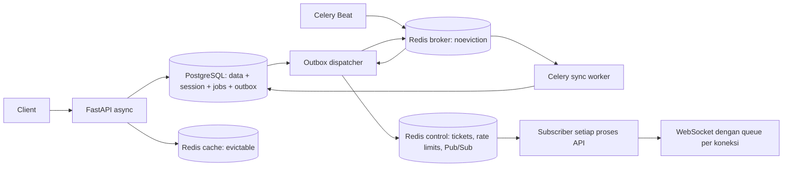

# Arsitektur dan kontrak keandalan

## Kepemilikan koneksi

- API membuat async engine, session factory, Redis clients dan outbound HTTP dalam
  lifespan; `AsyncExitStack` menutupnya secara terbalik bahkan ketika startup gagal.
- Satu `AsyncSession` per request, tidak dipakai bersamaan oleh beberapa coroutine.
  Service memiliki commit boundary; error/close membatalkan transaksi tersisa.
- API memakai asyncpg. Celery memakai SQLAlchemy sinkron + psycopg, resource dibuat
  lazy di child worker berdasarkan PID dan ditutup melalui signal shutdown.
  Tidak ada pool aktif sebelum fork, tidak ada client async lintas event loop.
- Pub/Sub punya client/pool tersendiri karena subscriber memakai koneksi panjang.
  Listener disimpan, dibatalkan dan ditunggu saat shutdown; reconnect memiliki backoff.

## Transaksi, outbox dan idempotensi

Membuat job dan outbox `job.requested` ada dalam satu transaksi PostgreSQL.
Beat memicu dispatcher setiap dua detik. Dispatcher mengunci batch menggunakan
`SKIP LOCKED`, mengirim task/publish event, lalu menandai delivered. Jika proses
mati di antara send dan commit, pengiriman bisa terulang: kontraknya **at least once**.
Consumer job memakai row lock dan pemeriksaan status sehingga duplikat tidak
membuat hasil atau event completion tambahan. Idempotency key unik per pemilik job.

Task report sengaja kecil: menghitung mata pelajaran. Tidak ada export file,
transaksi panjang, atau efek eksternal dalam contoh ini. Fitur baru dengan efek
eksternal harus memiliki idempotensi di downstream juga; row lock saja tidak
menjamin exactly-once pada layanan pihak ketiga.

Redis Pub/Sub bersifat sementara. Outbox melindungi publish saat Redis gagal,
tetapi pesan yang berhasil dipublish saat tidak ada subscriber tidak bisa di-replay.
State job PostgreSQL adalah sumber kebenaran. UI mengambil ulang state sesudah
reconnect, dan memakai event_id untuk mengabaikan duplikat.

## Kebijakan cache

CRUD membaca langsung PostgreSQL. Hanya endpoint statistik menggunakan cache,
dengan TTL 30 detik, namespace aplikasi/environment/version, generation key, dan
lock `SET NX EX`. Release lock memakai compare-and-delete Lua, bukan delete buta.
Jika lock sudah dimiliki pihak lain, request tetap menghitung tanpa menyimpan:
tidak ada penantian tanpa batas, tetapi ini bukan pencegahan stampede penuh.

Mutasi subject mencatat outbox invalidasi dan melakukan invalidasi langsung
setelah commit. Generation baru membuat hasil dari query lama tidak menimpa key
yang baru. Redis cache yang gagal tidak membuat commit bisnis gagal.
Statistik **eventually consistent**, bukan jaminan read-your-writes saat cache
sedang gagal pulih. TTL membatasi usia hasil setelah penulisan cache; untuk
keputusan akademik penting baca PostgreSQL langsung.

Tidak ada `FLUSHALL`, `FLUSHDB`, atau scan seluruh key untuk invalidasi request.
Cache LRU dipisahkan secara fisik dari broker dan control `noeviction`.
Nomor database Redis tidak mengisolasi Pub/Sub: channel wajib memakai namespace.

## Batas fondasi

Identitas global dengan role admin/teacher/student per sekolah. Multi-tenant dan OIDC
sudah tersedia; detail ada di [multi-sekolah/SSO](multischool-sso.md). Belum MFA,
password reset, pendaftaran publik, fitur ujian/LMS lengkap, atau migrasi data lama.
Model job mendukung task contoh yang seluruh efeknya satu transaksi. Untuk tugas
panjang, tambahkan progress/lease/retry state dan checkpoint per domain.
